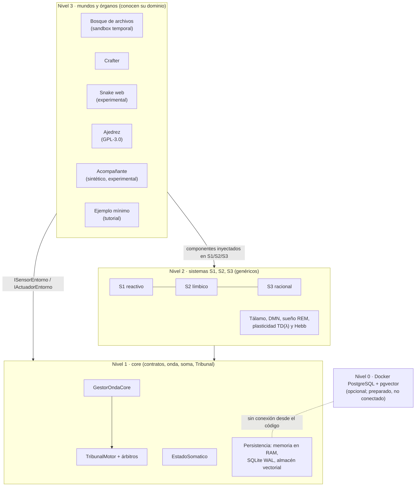
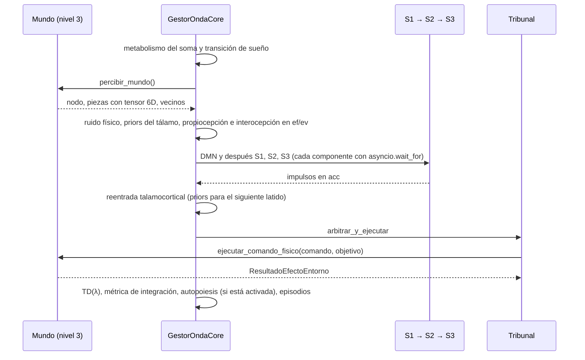

# Arquitectura de IdA

Versión 12.0.0 · 7 de noviembre de 2026 · Estado del proyecto: experimental.

Este documento describe cómo está construido IdA y qué hace cada pieza **según el código**. El estado de cada mecanismo usa siempre una de estas etiquetas: *activo, efecto medido* · *activo, efecto no medido* · *preparado, no conectado* · *simulado* · *no implementado* · *experimental, desactivado por defecto*. Los datos que respaldan cada etiqueta están en [`RESULTADOS_Y_VERIFICACION.md`](RESULTADOS_Y_VERIFICACION.md).

## 1. Capas

IdA separa un **core** que no conoce ningún mundo (niveles 1 y 2) de los **mundos** que se conectan a él (nivel 3). El nivel 0 es un servicio opcional.

| Nivel | Carpeta | Qué contiene | Regla |
|---|---|---|---|
| 0 | `nivel_0_demiurgo/` | `docker-compose.yml`, `init.sql`, `nivel_0_demiurgo/terraform/main.tf` | Opcional. Ningún módulo se conecta a esta base de datos |
| 1 | `nivel_1_core/` | Contratos (`contratos.py`), vocabulario cerrado (`vocabulario.py`), onda (`gestor_onda.py`), soma (`estado_somatico.py`), Tribunal y árbitros, persistencia | Sin vocabulario de dominio ni E/S (salvo persistencia y entropía), comprobado por el linter |
| 2 | `nivel_2_sistemas/` | S1, S2, S3, tálamo y DMN, sueño REM, plasticidad, autopoiesis | Igual que el nivel 1; no puede importar el nivel 3 |
| 3 | `nivel_3_componentes/` | Órganos universales de S3, adaptadores, componentes y runners de cada mundo, rutas de salida | Aquí vive todo el conocimiento de dominio |

## 2. El latido: ciclo de la onda

Cada paso de decisión es un **latido** (`GestorOndaCore.ejecutar_latido`, [`nivel_1_core/gestor_onda.py`](../nivel_1_core/gestor_onda.py)). Durante el latido, los sistemas escriben en una pizarra (`DimensionReactiva`, [`contratos.py`](../nivel_1_core/contratos.py)) con cuatro canales:

| Canal | Contenido | Propiedad |
|---|---|---|
| `ei` | Estado inicial: copia del `ef` del latido anterior | Solo lectura (`MappingProxyType`) |
| `ev` | Lo que el sistema atiende en este latido | Cada escritura consume **amplitud** (presupuesto de atención) |
| `acc` | Impulsos motores propuestos por S1, S2 y S3 | Cada impulso consume amplitud |
| `ef` | Registro final: percepción, interocepción y ejecución | Se convierte en el `ei` del siguiente latido |

Si el soma está dormido, el latido ejecuta el sueño REM y termina antes de los sistemas (`gestor_onda.py:157-161`).

## 3. Arbitraje: el Tribunal y los árbitros intercambiables

Todos los sistemas proponen en un **canal motor común** (`acc["Impulso"]`). El `TribunalMotor` ([`tribunal_motor.py`](../nivel_1_core/tribunal_motor.py)) delega la elección en un árbitro inyectable ([`arbitros.py`](../nivel_1_core/arbitros.py)). El árbitro por defecto, A0, puntúa cada impulso así (`arbitros.py:83-100`):

`puntuación = (arousal × estrés + confianza × (1 − estrés)) × modulador sináptico`

donde estrés es el cortisol del soma en [0, 1], y el modulador sináptico se acota en [0,80; 1,25] a partir del peso aprendido por TD(λ). A0 añade una regla de desesperación por inanición, un veto prefrontal y un desempate aleatorio cuando dos puntuaciones distan ≤ 0,03.

Los árbitros alternativos (A1 mayor arousal; A2 prioridad fija S1 > S2 > S3; A3 prioridad fija S3 > S2 > S1; A4 muestreo aleatorio ponderado por arousal; A5 solo S1; A6 solo S3; A7 mayor producto arousal × confianza, sin soma) se pueden poner en lugar de A0 sin tocar los sistemas. El Tribunal registra en cada latido, sin efectos sobre la decisión, qué habría elegido cada árbitro (**telemetría contrafactual**). Es la base de H1.

## 4. La membrana: contratos con los mundos

Un mundo se conecta implementando dos protocolos de [`contratos.py`](../nivel_1_core/contratos.py):

- `ISensorEntorno.percibir_mundo() -> (nodo_actual, piezas, nodos_adyacentes)`: cada `Pieza` lleva un `tensor_sensorial` de 6 dimensiones (proximidad, magnitud, movimiento, entropía, afinidad nutricional, nocicepción), `arousal`, `trust` y un `product` con banderas como `es_nutritivo` o `es_letal`.
- `IActuadorEntorno.ejecutar_comando_fisico(comando, objetivo) -> ResultadoEfectoEntorno`: el comando sale de un vocabulario cerrado (`V_Comando`: MOVER, DEGLUTIR, ASIMILAR, CENSURAR, ATACAR, COGER, SOLTAR, ESPERAR…). El resultado devuelve las consecuencias somáticas (alimentación, energía, daño…).

Los mundos de juego añaden además **componentes de dominio** en las estaciones de S1, S2 y S3 (por ejemplo `componentes_crafter.py`). El ejemplo mínimo demuestra que basta con el adaptador: usa los sistemas genéricos tal cual. Ver el tutorial en [`GOBERNANZA_Y_CONTRATOS.md`](GOBERNANZA_Y_CONTRATOS.md).

## 5. El linter como función de aptitud arquitectónica

[`tests_arquitectura/test_linter_pureza.py`](../tests_arquitectura/test_linter_pureza.py) recorre con `ast` todos los ficheros de los niveles 1 y 2. Es un **análisis léxico** del árbol sintáctico. Su cobertura se midió con 23 fragmentos de prueba ([`analisis/sondear_linter.py`](../analisis/sondear_linter.py), datos en [`N7_cobertura_linter.csv`](../analisis/resultados/N7_cobertura_linter.csv)):

| Detecta (14 de 23) | No detecta (9 de 23) |
|---|---|
| Literales con vocabulario de dominio, también partidos (`"cra" + "fter"`), en f-strings, en bytes con escapes, en docstrings y como claves de diccionario | Cadenas construidas en ejecución: `"".join([...])`, inversión `[::-1]`, `chr()`, `str.format` |
| Identificadores (variables, funciones, atributos, argumentos) con vocabulario de dominio | Imports dinámicos de módulos de E/S (`importlib.import_module("sub" + "process")`) |
| `import` estático de librerías de E/S o de mundo, e imports del nivel 3 | Constantes calibradas usadas en comparaciones (`if n == 22`) o como valor por defecto |
| Constantes numéricas calibradas para un mundo **en asignaciones** (22, 64, 315, 1320…) | Sinónimos no listados y umbrales afinados sin vocabulario delator |

Por tanto, la formulación correcta es: *el aislamiento se hace cumplir con un linter AST de cobertura léxica; detecta vocabulario e imports explícitos y no detecta construcción dinámica ni conocimiento de dominio sin palabras delatoras*. Además, una **prueba metamórfica** ([`test_metamorfico_aislamiento.py`](../tests_arquitectura/test_metamorfico_aislamiento.py)) renombra todos los identificadores del mundo de ejemplo y comprueba que, con el ruido aislado, la conducta latido a latido es idéntica durante 60 latidos. Límite: el almacén vectorial genera embeddings con SHA-256 del identificador, pero hoy nadie lo alimenta, así que esa vía no se ejerce.

## 6. Qué aporta el core y qué aporta el mundo

- En **Bosque** y en el **ejemplo mínimo**, los componentes genéricos del nivel 2 deciden solos.
- En **Crafter, Snake y Ajedrez**, el conocimiento táctico está codificado en los componentes de nivel 3: árbol tecnológico y búsqueda en Crafter, BFS y *flood fill* en Snake, minimax y evaluación en Ajedrez. Ese código es mayor que el adaptador ([`coste_adaptacion.csv`](../analisis/resultados/coste_adaptacion.csv): Crafter 556 líneas de adaptador, 921 de componentes y 1599 de runner y herramientas).
- Lo que el core aporta en esos mundos es **cómo se arbitra** entre propuestas de S1, S2 y S3, la modulación por el estado somático y el presupuesto por latido. La parte medida es H1 (Crafter). El reparto de decisiones por sistema está en [`RESULTADOS_TABLAS.md`](RESULTADOS_TABLAS.md).

## 7. Estado de cada mecanismo

Resumen de la matriz N5. Los recuentos son invocaciones reales en episodios cortos ([`N5_mecanismos_conectados.csv`](../analisis/resultados/N5_mecanismos_conectados.csv)); el detalle está en [`RESULTADOS_Y_VERIFICACION.md`](RESULTADOS_Y_VERIFICACION.md#5-matriz-mecanismo-documentado--conectado-n5).

| Mecanismo | Dónde | Estado |
|---|---|---|
| Arbitraje del Tribunal (A0) y árbitros intercambiables | `tribunal_motor.py`, `arbitros.py` | Activo, efecto medido (H1, Crafter) |
| Telemetría contrafactual | `tribunal_motor.py` | Activo (instrumentación) |
| Modulación por cortisol | `arbitros.py`, `estado_somatico.py` | Activo; efecto medido en H2 tras corregir la manipulación (ver resultados) |
| S2 límbico | `s2_limbico.py` + componentes de dominio | Activo, efecto medido (H7, Crafter) |
| Bucle talamocortical (priors del siguiente latido) | `consciencia_talamo_dmn.py` | Activo, efecto no medido |
| Red por defecto (DMN) | `consciencia_talamo_dmn.py` | Activo, efecto no medido |
| Métrica de integración inspirada en IIT («Φ») | `calculadoras_estructurales.py` | Activo **solo como métrica**: se calcula después de decidir y no interviene en la decisión |
| TD(λ) | `plasticidad_td_hebbiana.py`, `sistema_base.py` | Activo, efecto no medido (H6 pendiente) |
| Hebb de tres factores | `plasticidad_td_hebbiana.py`, `s1_reactivo.py` | Evalúa en todos los mundos; **actualiza pesos solo en Bosque**. Efecto no medido |
| Sueño REM | `ciclo_sueno_rem.py` | Activo, efecto no medido por separado (la regla de sueño de Crafter está dentro de H7) |
| Guillotina (plazo por latido) | `sistema_base.py`, `contratos.py` | Activo como **plazo cooperativo**; no se disparó en ningún episodio contado. No es tiempo real |
| Memoria alocéntrica en RAM | `memoria_tridimensional.py` | Activo (la usan los componentes de Crafter) |
| SQLite WAL | `motor_sqlite_wal.py` | Activo **solo escritura**: nada vuelve a leerlo (`cargar_hacia_activa` no se llama) |
| Almacén vectorial / pgvector | `motor_pgvector.py`, `nivel_0_demiurgo/` | **Preparado, no conectado**: sin driver de PostgreSQL; el almacén en memoria se consulta pero nunca se escribe |
| Herencia de axiomas (barrera de Weismann) | runners, JSON de linaje | Activo; efecto medido: no apoyado (estudio factorial) |
| Autopoiesis AST | `autopoiesis_ast.py` | **Experimental, desactivado por defecto** (`--habilitar-autopoiesis`) |
| Servidor MCP | `servidor_mcp_telemetria.py` | Activo solo en la demo; despachador JSON-RPC **en proceso, sin puerto de red**. El recurso `ida://fenomenologia_phi` devuelve siempre 0 porque lee un atributo que nunca se asigna |
| Órgano «imaginación LLM» de S3 | `comp_imaginacion_llm.py` | **Simulado**: espera un tiempo y aplica una regla; no llama a ningún LLM |
| LLM local (Ollama) | `componentes_ajedrez.py` | Opcional en ajedrez; no medido (las mediciones se hicieron sin Ollama) |
| Modo Lichess del ajedrez | `adaptador_ajedrez.py` | **No implementado** (solo declarado) |
| Visión ASCII | — | **No implementado** (no existe en el código) |

## 8. Concurrencia y tiempo

- Cada componente cognitivo se ejecuta dentro de `asyncio.wait_for` con el tiempo que queda del latido (`sistema_base.py:106`). Si se agota, se lanza `LatidoAgotadoException` y el Tribunal decide con lo que ya haya en `acc`.
- **Lección del proyecto:** un plazo cooperativo no corta un cálculo síncrono (BFS o minimax sin `await`), y un hilo de Python no se puede matar. Por eso el plazo se describe como «cooperativo», nunca como «tiempo real».
- El navegador de Snake y la consulta a Ollama corren en un `ThreadPoolExecutor` de un hilo para no bloquear el bucle.

## 9. Determinismo y ruido

- El ruido «físico» del cosechador combina `os.urandom` con el jitter del reloj (`cosechador_termodinamico.py`): no es reproducible por diseño.
- Para reproducir trayectorias exactas se aísla (`--aislar-ruido` en el harness y en el ejemplo mínimo).
- En Crafter, el orden de iteración de un `set()` del motor introducía deriva no determinista; el adaptador lo corrige con `_DeterministicChunkSet` (`adaptador_crafter.py:93`).

## 10. Seguridad de ejecución

- **Bosque:** solo opera dentro de un directorio temporal creado para él (prefijo `ida_bosque_`) y confina todas las operaciones a su raíz (tests en [`test_seguridad_ejecucion.py`](../tests_arquitectura/test_seguridad_ejecucion.py)).
- **Autopoiesis:** desactivada por defecto. Cuando se activa, muta clases **en memoria** con `exec` y no escribe código en disco.
- **Salidas:** ningún programa escribe en las carpetas de código; todo va a `IDA_OUT_DIR` (por defecto `./salidas/`, ignorado por git).

Detalle en [`SECURITY.md`](../SECURITY.md).

## 11. Límites conocidos

- El linter es léxico (sección 5).
- El conocimiento de los juegos está codificado en el nivel 3; el core no aprende Crafter, Snake ni Ajedrez desde cero.
- H1 solo está medida en un mundo (Crafter).
- La plasticidad, la guillotina, el tálamo, la DMN y el REM no tienen efecto medido.
- La memoria vectorial y PostgreSQL están preparados, no conectados.
- El barrido activo de cada componente (`procesar_activa`, `sistema_base.py:54`) está preparado pero ningún componente lo implementa. La cuota de frecuencia de cada sistema (`cuota_frecuencia_ratio`: 0,25, 0,30 y 0,45) está declarada, pero el código no la usa.
- El efecto del lenguaje interno formal no se ha medido (sección 12).

## 12. Lenguaje interno formal

Además de impulsos, los sistemas escriben piezas formales: `Predicado_*`, `Proposicion_*` (VERDAD, DUDA, VALOR…), `Sentencia` y `Logica_CAUSAL` ([`contratos.py`](../nivel_1_core/contratos.py)), con modalidades, relaciones y vínculos de vocabulario cerrado (`V_Modalidad`, `V_Relacion`, `V_Vinculo` en [`vocabulario.py`](../nivel_1_core/vocabulario.py)).

El Tribunal solo arbitra `acc["Impulso"]` (`tribunal_motor.py:106`). Una pieza formal solo influye en la conducta si un componente la lee y por eso crea o modifica un impulso. Casi todos los caminos están en los sistemas genéricos del nivel 2 y en los órganos de S3. La excepción son los componentes de Crafter, que no leen el contenido de las proposiciones pero sí cuentan cuántas hay en memoria (fila «Decide por recuento»). Snake y Ajedrez no leen piezas formales para decidir.

| Clase | Camino | Dónde |
|---|---|---|
| **Decide** | Si duda de un objeto (`Proposicion_DUDA`) y hay una fuente de conocimiento visible, S3 propone consultarla (ASIMILAR) | `s3_racional.py:472-502` |
| **Decide** | Si un impulso quiere comerse algo en duda, S3 lo frena y lo cambia por cogerlo; si hay una `Proposicion_VERDAD` demostrada de que es nutritivo, lo deja pasar | `s3_racional.py:512-526`; la proposición se demuestra al verificar una hipótesis (`memoria_tridimensional.py:135-176`) |
| **Decide por recuento** (Crafter) | S1 y S3 de Crafter cuentan las `Proposicion_VERDAD` de la memoria, junto con traumas y patrones heredados, para ajustar sus umbrales de hambre y sed: el de urgencia visceral de S1 y el «umbral alostático» con el que S3 deja de hacer tareas pasivas | `componentes_crafter.py:114-123`, `773-795` |
| Decide si se activa | La planificación por BFS elige destino leyendo proposiciones y reglas del grafo y propone MOVER | `s3_racional.py:375-443` |
| Decide si se activa | Una proposición «letal» frena el impulso de comerse ese objeto | `s2_limbico.py:301-310` |
| Decide si se activa | Un predicado de valor «armónico» crea un impulso COGER y baja el cortisol | `s2_limbico.py:313-328`, `consciencia_talamo_dmn.py:74-80` |
| Decide si se activa | Una regla lógica «letal» sube el arousal del objeto antes de decidir | `consciencia_talamo_dmn.py:38-48` |
| Decide si se activa | Una sentencia de otro emisor activa la teoría de la mente, que veta impulsos hacia el cebo (solo montada en la demo) | `comp_teoria_mente.py:28-87`, `main.py:58-62` |
| Estructura | Silogismo: [A análogo a B] y [B implica C] ⇒ [A implica C] (DEDUCTIVO) | `s3_racional.py:115-142` |
| Estructura | Sentencias de comunicación y metacognitivas («[IdA CREE (IdA ES_FIABLE)]»), predicados y proposiciones de valor de cada concepto, reglas vicarias | `s3_racional.py:62-112`, `186-277`; `s2_limbico.py:100-180` |
| Estructura | Proposición ontológica y sentencia intencional del ajedrez | `componentes_ajedrez.py:229`, `416` |
| Estructura | Canal `acc["Expresion"]` (señuelos de la teoría de la mente y de S3): el Tribunal no lo arbitra | `comp_teoria_mente.py:89-114`, `s3_racional.py:610-622` |
| Cuenta, pero no se lee | Axiomas heredados de Crafter: se guardan como `Proposicion_VERDAD` con claves `Axioma_Logro_*` y `Axioma_Supervivencia_Gen*`. Los lectores que buscan por el identificador de la entidad no los encuentran; solo suman en el recuento de la fila «Decide por recuento». Sin axiomas, el propio individuo crea proposiciones VERDAD desde los primeros latidos (4 en el latido 5 y 17 en el 20, semilla 7), así que el recuento cambia lo mismo con o sin herencia. Es coherente con el resultado medido (+0,00 logros) | `mundo_crafter_runner.py:528-532`, `710-745` |
| Solo tests | Abstracción y analogías del sueño REM | `ciclo_sueno_rem.py:84-196`; `test_fases_sueno_rem_abstraccion_y_analogias` |
| No conectado | Intuición sintetizada desde el almacén vectorial (nunca se escribe en él) | `motor_pgvector.py:145` |

**Comprobación del 8 de noviembre de 2026.** Se ejecutaron el ejemplo mínimo (60 latidos), la demo del Bosque (60 latidos), Crafter con las semillas de desarrollo 7 y 8 (300 latidos; sin axiomas y con los del linaje de ejemplo) y dos partidas de ajedrez, contando con envolturas de solo lectura qué impulso ganaba en cada decisión (mismo método que N5). Los dos caminos de la clase «Decide» ganaron decisiones:

- La consulta por duda: 6 de 12 en el Bosque.
- Comer lo ya demostrado: entre 7 y 9 de 60 en el ejemplo mínimo y entre 2 y 4 de 474 en Crafter.

La planificación por BFS propuso 8 movimientos en Crafter sin ganar ninguno, y los demás caminos no se activaron. En Ajedrez y en casi todo Crafter deciden los componentes de dominio. La fila «Decide por recuento» se añadió el 8 de noviembre, después de la comprobación: la sonda no la medía. Sin `--aislar-ruido`, los recuentos variaron ligeramente entre ejecuciones.

Los datos de esta comprobación salen de una sonda de solo lectura que se publicará en la v13.

## 13. Hallazgos de la v14 sin corregir

Lectura del código y línea base del paso 0 de la v14 (9 de noviembre de 2026), con una sonda de solo lectura que exige la misma trayectoria con y sin sonda ([`v14/analisis_paso0/`](../v14/analisis_paso0/)). Ninguno se ha corregido: corregir cualquiera de ellos, salvo los dos últimos, cambia la conducta, así que iría tras un flag y se mediría aparte.

| Hallazgo | Evidencia | Efecto |
|---|---|---|
| **Prioritario: en Crafter el cuerpo simulado está saturado.** La alimentación del soma baja 0,8 por latido en vigilia y se queda en una mediana de 5,8 sobre 100 mientras la comida del juego está casi siempre entre 6 y 9 de 9. La vitalidad del soma es 0 en el 32 % de los latidos con el personaje vivo | [`estado_somatico.py`](../nivel_1_core/estado_somatico.py) (líneas 119-141); Crafter, semillas de desarrollo 0–9, 2809 latidos | La urgencia de S1 vale 1,0 en más de la mitad de los latidos y el estado MIEDO ocupa el 77 %. Las señales internas no distinguen situaciones, y las reglas del Episodio con señales del soma no segmentan |
| El runner de Crafter intenta quitar de S3 el componente `"Comp_Impulso_S3"`, pero se llama `"Comp_ImpulsoS3"`: el filtro no quita nada | [`mundo_crafter_runner.py`](../nivel_3_componentes/mundos/mundo_crafter/mundo_crafter_runner.py) (líneas 508-510 y 853-855); [`s3_racional.py`](../nivel_2_sistemas/s3_racional.py) (línea 465) | `CompImpulsoS3` sigue activo en Crafter (en H1, H7 y N1). Gana el 0,2 % de los latidos, pero proyecta una expectativa en cada uno, y eso alimenta la sorpresa (33 % de los latidos) |
| Los axiomas heredados de Crafter hablan del individuo o de los logros, no de entidades del mundo | `mundo_crafter_runner.py` (líneas 685-745) | Los lectores por tipo de Crafter los cuentan ([`componentes_crafter.py`](../nivel_3_componentes/mundos/mundo_crafter/componentes_crafter.py), líneas 114-124 y 773-790). Los lectores por identificador de S2 y S3 no los pueden encontrar por construcción: no hay una entidad con la que casarlos. Cambiar las claves no crea ningún uso |
| `cuota_frecuencia_ratio` se declara y no se usa | [`sistema_base.py`](../nivel_2_sistemas/sistema_base.py) (líneas 69-71) | En los mundos medidos el latido usa como mucho el 9 % del plazo, así que tampoco tendría efecto. Podría tenerlo en Snake (plazo de 120 ms) |
| ALERTA no se asigna nunca | [`vocabulario.py`](../nivel_1_core/vocabulario.py) (línea 78); S2 asigna los estados en [`s2_limbico.py`](../nivel_2_sistemas/s2_limbico.py) (líneas 208-268) | Ninguna decisión lee CALMA, MIEDO, PÁNICO ni CURIOSIDAD (solo DORMIDO, CULPA y SENESCENTE), así que asignarla cambiaría la etiqueta, no la decisión |
| Los dos índices de la memoria activa pueden separarse: al demostrarse una duda, `indice_por_tipo` no se actualiza | [`memoria_tridimensional.py`](../nivel_1_core/persistencia/memoria_tridimensional.py) (líneas 171-177) | Al final del ejemplo mínimo (200 latidos) hay 3 `Proposicion_VERDAD` en `indice_identidad` y ninguna en `indice_por_tipo` |
| Las expectativas de S3 se guardan por objetivo y se consumen por ubicación | `s3_racional.py` (líneas 220 y 624-630) | Las expectativas sobre entidades (comer, coger, atacar) no se validan nunca y se acumulan: de 24 a 34 al final de una partida de Crafter |
| Ningún adaptador pone `es_zona_segura` | búsqueda en `nivel_3_componentes/` | El sacrificio de S1, el depósito en el nicho y la meta de zona segura por estar en ella no se activan nunca |
| El plazo real no es 100 ms | ejemplo mínimo 5000 ms; Crafter 2500 ms; Ajedrez 3000 ms; Snake 120 ms | 100 ms es solo el valor por defecto del núcleo. La latencia mediana medida va de 1,5 a 8 ms |
| `Pieza.updated` no se actualiza después de crear la pieza, y `created`/`updated` son hora de reloj | [`contratos.py`](../nivel_1_core/contratos.py) (líneas 87-88 y 132-133) | No sirven para el olvido: no son reproducibles. La v14 usa marcas en latidos |

## 14. Flags de la v14 (E2–E4) y hallazgos

Los flags viven en [`v14/parametros_mundo.json`](../v14/parametros_mundo.json), uno por mundo y **todos apagados por defecto**. Con todo apagado, la v14 es idéntica a la v13: lo comprueba el canario H7 en la CI. Los modificadores se instalan desde [`v14/modificadores.py`](../v14/modificadores.py) en las instancias de cada partida; no cambian ningún fichero del núcleo ni de los mundos. El preregistro está en [`v14/preregistro_E2_E4.md`](../v14/preregistro_E2_E4.md).

| Flag o ajuste | Clase | Qué hace | Por defecto | Resultado de E2–E4 |
|---|---|---|---|---|
| `memoria_experiencia`, `observar_activa`, `observar_proactiva`, `indicadores_generales` | Observadores | Pasos 2 y 3 (`v14/observador/`): almacén propio, recuperación y expectativas registradas, sin influir en la decisión | apagados (`"apagada"`) | Pasos 2 y 3 de la v14 |
| `peligro_crafter` (ajuste) | Observador | El peligro que leen los observadores en Crafter: el de S1 (`"s1"`) o las piezas de peligro del juego que entrega el adaptador (`"juego"`) | `"s1"` | Coinciden en el 100 % de los latidos con todo apagado |
| `calibracion_cuerpo_crafter` | Modificador | P1: factor del lastre de la carga; P1': factor del desgaste basal; P2: alcance del peligro en la percepción | apagado (1,0; 1,0; sin límite) | **No medido**: el bloque se cerró en la puerta A1 del preregistro |
| `curiosidad_intrinseca` | Modificador | Componente de S2 que propone moverse al nodo adyacente menos visitado, solo sin peligro ni hambre y con amplitud sobrante, siempre por debajo de S1 en la puntuación A0 | apagado (peso 0,5) | **No recomendado**: propone, pero no gana ningún arbitraje en Crafter (40 de 40 trayectorias idénticas; cambio en logros 0) |

Hallazgos de E2–E4, sin corregir:

| Hallazgo | Evidencia | Efecto |
|---|---|---|
| En Crafter, cada resultado del actuador lleva un `objeto_cargado` con el estado del jugador, y el soma lo toma como carga tras cualquier COGER | [`adaptador_crafter.py`](../nivel_3_componentes/mundos/mundo_crafter/adaptador_crafter.py) (líneas 678-686); [`estado_somatico.py`](../nivel_1_core/estado_somatico.py) (líneas 120 y 200-201) | Desde el primer COGER, el soma resta 0,5 más por latido. Explica el 40,5 % del descenso de la alimentación simulada. El resto (59,2 %) son caídas reales de comida y bebida del juego, que el soma sigue con r = 0,90 y sin desfase |
| El peligro de S1 en Crafter es binario: 1,0 en cuanto hay un depredador, una flecha o lava en la ventana de 13 × 13 casillas, a cualquier distancia | `adaptador_crafter.py` (líneas 261-284 y 335); semillas 30–49 | El 70 % de los latidos de miedo tiene peligro, y solo el 29 % se debe solo a la inanición. El miedo ocupa el 80 % de los latidos en vigilia |
| La curiosidad intrínseca, limitada a quedar por debajo de S1, no gana nunca en Crafter | Semillas 90–129 y 170–209 | Su efecto medido es nulo. Para que cambie algo haría falta otra regla de prioridad, que el encargo excluye |
| Beber agua, que el vocabulario llama nutritiva, mejora el balance del episodio solo en el 16 % de los casos (n = 1332) | Observador de la proactiva, semillas 30–49 y 130–169 | Ninguna regularidad (acción, clase) alcanza el 70 % de estabilidad: el resultado depende de la situación, no solo de la acción |

## 15. Flags de la v14 (E5) y hallazgos

Preregistro: [`v14/preregistro_E5.md`](../v14/preregistro_E5.md). Todo apagado por defecto.

| Flag o ajuste | Clase | Qué hace | Por defecto | Resultado de E5 |
|---|---|---|---|---|
| `registrar_arbitraje` (ajuste) | Observador | Registra los candidatos que llegan al Tribunal, su clase (supervivencia, relleno o propósito), su puntuación A0, el margen y qué árbitros discrepan ([`v14/arbitraje.py`](../v14/arbitraje.py)) | apagado | Bloque D |
| `creencias` (ajuste) | Observador | Al morir, escribe en `.md` y `.json` las piezas formales de la memoria del núcleo: demostradas, falsadas y dudosas ([`v14/observador/creencias.py`](../v14/observador/creencias.py)) | apagado | Bloque G2 |
| `corregir_carga_falsa_crafter` | Modificador | El soma de Crafter solo lleva carga si el inventario del juego tiene un objeto de `carga_pesados` | apagado; `carga_pesados = ["iron", "diamond"]` | **No recomendado**: lo no explicado por el juego baja del 44,6 % al 15,5 % (objetivo < 10 %), y el IC de logros y de latidos no cumple la no inferioridad |
| `curiosidad.regla` (ajuste) | Modificador | `"relleno"`: la curiosidad puede ganar solo frente a un candidato de relleno y sin supervivencia de S1 | `"bajo_s1"` | **No implementado en la medición**: la puerta D3 dio «no hay margen» |

Hallazgos de E5, sin corregir:

| Hallazgo | Evidencia | Efecto |
|---|---|---|
| En Crafter casi no hay decisiones indiferentes: en calma (el 21 % de los latidos) gana S3 con propósito el 96 % de las veces, con un margen mediano de 0,50 en la puntuación A0. Solo el 1,15 % de los latidos en calma tienen ganador de relleno o margen < 0,05 | Semillas 30–49, `registrar_arbitraje` | Un candidato nuevo de un Sistema apenas tiene sitio para ganar sin cambiar el núcleo |
| En el ejemplo mínimo, el 76 % de las decisiones tienen un margen < 0,05 (al menos la mitad son empates exactos: la mediana del margen es 0), y la bifurcación de Prigogine elige al segundo en el 75 % de los latidos, porque con el ruido aislado `cosechar_unidad_uniforme` vale siempre 0,5 | `arbitros.py` (líneas 113-119); ejemplo mínimo, 200 latidos | Con el ruido aislado, los empates se resuelven siempre a favor del segundo candidato |
| La memoria formal del núcleo casi nunca desmiente: en Crafter, cada individuo muere con unas 98 creencias demostradas y 0 falsadas, y la mitad de las demostraciones dura más de 140 latidos. Muchas son extrañas («DORMIR es nutritivo», «nodo_20_25 es nutritivo») | Semillas 30–49, ajuste `creencias` | Las hipótesis del observador (paso 3) se ganan y se pierden, pero las del núcleo no; la inestabilidad del paso 3 parece del mundo, no del criterio |
| Corregir la carga falsa mejora el cuerpo de Crafter, aunque no el juego: el miedo baja del 74 % al 57 %, la alimentación en un extremo baja del 50 % al 18 % y su mediana sube de 10,6 a 45,5 | Semillas 210–249 | El efecto en logros y en vida no se distingue de cero (IC anchos; 33 de 40 trayectorias cambian) |

## 16. Hallazgos de la v14 (E6)

Preregistro: [`v14/preregistro_E6.md`](../v14/preregistro_E6.md). No hay flags nuevos: el bloque L (`activa_modulacion`) no se construyó porque la puerta del contrafactual dio «no ejercitable». Los observadores de E5 guardan ahora además el objetivo de cada candidato (`registrar_arbitraje`) y las evidencias de cada creencia (`creencias`), y el ejecutor admite `--carga-pesados` (lista vacía: el soma de Crafter no lleva carga nunca). Todo sigue apagado por defecto. Hallazgos, sin corregir:

| Hallazgo | Evidencia | Efecto |
|---|---|---|
| Las confirmaciones de «X es nutritivo» en Crafter son espurias: el adaptador suma +0,8 a la alimentación en cada acción ejecutada (compensa el desgaste), así que casi cualquier acción da `verdad_verificada` sobre su objetivo y S3 la confirma | [`adaptador_crafter.py`](../nivel_3_componentes/mundos/mundo_crafter/adaptador_crafter.py) (líneas 642 y 664-666); [`s3_racional.py`](../nivel_2_sistemas/s3_racional.py) (líneas 170-185) | De las creencias «nutritivas» de Crafter, el 97,8 % de las veces que el individuo actuó sobre su objeto, la comida y la bebida del juego **no** subieron, y la creencia se mantuvo. Así salen «DORMIR es nutritivo» o «nodo_35_40 es nutritivo» |
| Las proposiciones del núcleo no se pueden desmentir: la única rama que baja su confianza exige `balance_positivo = False`, y los tres llamadores pasan `True` | [`memoria_tridimensional.py`](../nivel_1_core/persistencia/memoria_tridimensional.py) (líneas 178-180); `s1_reactivo.py` (líneas 45-61); `s3_racional.py` (líneas 176-181) | El 100 % de las creencias demostradas al morir (Crafter, ejemplo mínimo y Bosque) no tiene camino de desmentido. Solo las reglas lógicas vicarias se extinguen (`s3_racional.py`, líneas 193-217) |
| En Crafter, modular las puntuaciones existentes cambia muy pocas decisiones: con m ≤ 0,126 (25 % del margen mediano), el ganador cambia en el 1,1 % de los latidos con un episodio parecido recordado. Hace falta m = 0,50, el propio margen mediano, para llegar al 10 % | Semillas 30–49 (contrafactual, `v14/analisis_e6.py`) | La activa por modulación no se construyó |
| La atribución de E5 y E6 contaba como lastre la carga que un COGER deja al final del latido, aunque la corrección la borra antes del metabolismo | `v14/analisis_e5.descenso_por_vida` | Con la lista vacía, lo no explicado por el juego medido es del 12,6 %, pero el real es del 1,5 % (el desgaste no compensado) |
